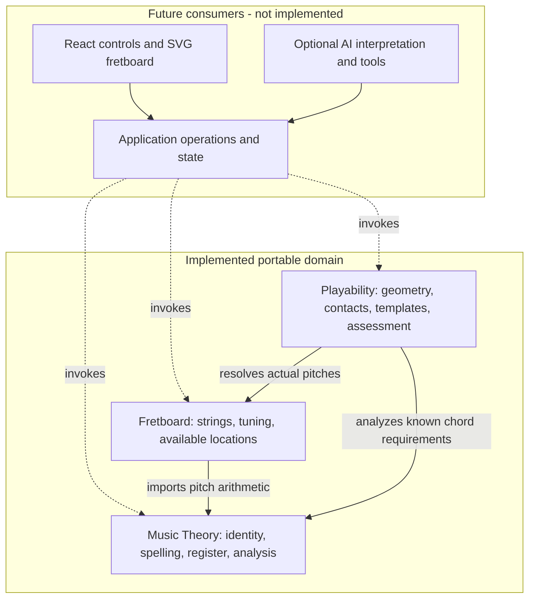

# Architecture, development and data flow

[Onboarding index](README.md) · Next: [Music Theory foundations](music-theory-engine.md)

## Product intent and the implemented system

The intended workbench supports both exploration and composition: inspect notes and relationships, map them onto a configured instrument, and find practical ways to play chords. These uses share the same computations. A chord used in an arrangement does not need a different definition from the same chord inspected in a theory exercise. The musician supplies creative direction; the system supplies deterministic transformations and evidence.

[D001](../DECISIONS.md#d001-deterministic-domain-authority), [D002](../DECISIONS.md#d002-a-useful-standalone-application-with-shared-domain-capabilities), [D003](../DECISIONS.md#d003-one-system-for-exploration-and-composition) and [D004](../DECISIONS.md#d004-domain-first-construction) explain why the domain precedes AI integration. Musical rules must remain available through ordinary application controls, independently of a model's availability or interpretation. AI is intended to translate intent into requests and orchestrate existing capabilities; it must not become another implementation of chord construction or fingering validation.

The implemented modules already compose without application integration. For example, Playability can search a selected E-shaped template for A-flat major on an explicit board, validate its contacts, and report musical matching and reviewed-pattern support. There is no application service, route, UI control or AI tool exposing that path yet.

Solid arrows within the domain indicate dependency/call direction. Dashed arrows are intended consumer calls, not implemented wiring. Results return to the caller. A note-location query needs no Playability call; a chord-template search does.

## Why three responsibilities exist

Consider C major. Its formula says root, major third and perfect fifth: C, E and G. That definition is independent of instrument tuning. The same C4 can occur on several guitar strings, and a tuning change moves those alternatives without changing C major. Finally, selecting individually available C/E/G locations does not establish simultaneous execution: two notes may compete for one string, or a barre may obstruct an intended open string.

| Owner | Answers | Does not establish |
| --- | --- | --- |
| Music Theory | What pitches and written roles are requested? What does a supplied voicing contain? | Locations, finger assignments, comfort. |
| Fretboard | What pitch sounds at this string/fret? Where can this class or exact pitch occur? | Simultaneous assignment, chord membership, finger contacts. |
| Playability | Does this geometry exist, do these contacts produce its stops, does the music match, and is the complete pattern reviewed? | General fingering solving, anatomical feasibility or ergonomic ranking. |
| Future application | Which operation expresses the user's request? What inputs and results should be retained and presented? | New musical rules embedded in UI handlers or prompts. |

[D019](../DECISIONS.md#d019-discrete-fretboard-and-practical-chord-fingerings) gives Playability the broader responsibility for practical validation/ranking. [D056](../DECISIONS.md#d056-reusable-playability-templates-and-bounded-placement-search) defines the narrower implemented boundary. Do not read a responsibility statement as proof that every intended algorithm exists.

## Repository map

| Location | Contents and role |
| --- | --- |
| [app/](../../app/) | App Router root layout, metadata, global styling and a generic home page. No domain imports or interactive product features. |
| [domain/music-theory/](../../domain/music-theory/) | Thirty modules in five subject folders: pitches/spelling, intervals, scales/modes, degrees/keys and chords. |
| [domain/fretboard/fretboard.ts](../../domain/fretboard/fretboard.ts) | Explicit instrument model and four mapping operations. |
| [domain/playability/](../../domain/playability/) | Seven modules for geometry, absolute contacts, relative templates, reference data, assessment and search. |
| [tests/](../../tests/) | Forty-one suites, including cross-module acceptance paths and compile-time assertions. |
| [tests/helpers/chord-catalog.ts](../../tests/helpers/chord-catalog.ts) | Test-only catalog verification using independent musical fixtures. Not a production registry. |
| [lib/utils.ts](../../lib/utils.ts) | Re-exports the `cn` class utility for presentation. It contains no musical rules. |
| [docs/](../) | Architecture, decisions, references, v1 handoffs and this onboarding guide. |
| [plans/](../../plans/) | Self-contained efforts and historical evidence, not a single global roadmap. |
| [AGENTS.md](../../AGENTS.md), [.agent/PLANS.md](../../.agent/PLANS.md) | Working rules and significant-effort planning protocol. |

Music Theory's subject folders follow the reference headings; they are not separate packages. The repository is one private npm application package under [D018](../DECISIONS.md#d018-one-private-application-package-with-an-independent-domain). There are no barrel exports or published engine packages. Callers import from concrete modules, using relative `.js` specifiers in TypeScript as the domain and tests do.

## The data that crosses boundaries

The model deliberately has multiple representations rather than one universal musical object:

| Representation | Retains | Information absent or discarded |
| --- | --- | --- |
| `NoteSpelling` | Letter and accidental, e.g. B-sharp. | Octave. |
| `RegisteredNote` | Spelling and written octave, e.g. B-sharp3. | Instrument placement. |
| `PitchClass` | Octave-equivalent sound, e.g. C = 0. | Spelling and register. |
| `RegisteredPitch` | Sounding semitone coordinate, e.g. 48. | Spelling; 48 may have come from C4 or B-sharp3. |
| Chord description | Root, ordered degree formula and optional specified bass. | Concrete voicing and instrument assignment. |
| Registered voicing | Every supplied tone occurrence, its order and register; optionally exact spelling. | Chord identity unless retained separately. |
| `FretboardPitchLocation` | String ID, fret and exact sounding pitch. | Source role, spelling, occurrence identity and physical position. |
| `ChordShapeInstance` | One explicit state per instrument string, with absolute sounding stops. | Finger contacts and musical identity. |
| `FingeringWitness` | Complete absolute contact duties associated with an instance. | Approval and chord identity. |
| `PlayabilityAssessment` | Copied requirements and separate structure, music, witness and support findings. | Preference score or universal comfort claim. |

These projections are useful, but they are lossy. A caller displaying a scale should retain its tonic, type, spelling and degree metadata alongside numeric locations. A caller requiring two C4 occurrences must keep both source entries; a pitch-class set would collapse them. Fretboard locations carry no source occurrence IDs, so an occurrence-aware consumer retains its own associations. Playability's `exactVoicing` assessment implements that stronger occurrence matching for supplied shapes.

The [Music Theory handoff](../MUSIC_THEORY_V1.md#information-to-retain-at-the-fretboard-boundary) and [Fretboard handoff](../FRETBOARD_V1.md#information-playability-must-retain) explain these retention contracts. The [examples](end-to-end-examples.md) demonstrate them without introducing a new shared schema.

## Dependency organization inside the domain

At the bottom, pitch-class arithmetic has no imports. Spelling and registered pitches build on it. Interval transposition combines written letter movement with chromatic distance. Scales reuse intervals; degree and key operations reuse scale/interval knowledge. Chord formulas reuse degree resolution. Named chord constructors route through descriptions and the shared formula resolver.

Higher chord operations consume those contracts: symbol parsing selects formulas; root-position realization adds register; analysis compares a supplied voicing to a known description; identification independently enumerates exact catalog identities. Identification is not called by the known-chord analyzer and does not decide how to spell a result.

Fretboard imports only Music Theory pitch types and arithmetic. Playability's structural resolver calls Fretboard; witness validation calls structural resolution; relative templates use those validators; assessment adds Music Theory analysis and private reviewed-pattern snapshots; search orchestrates placement and assessment. Music Theory does not import either instrument engine. Domain modules contain no React, Next.js, Node filesystem/network, UI library or AI imports.

Small tables hold fixed knowledge, such as natural-letter coordinates, scale intervals and chord formulas. Pure functions derive results from explicit inputs. The private identification catalog and reviewed Playability snapshots are constructed from domain data; callers receive copies and cannot grant review support by altering a returned record.

## Validation, errors and ownership

There is no universal runtime schema boundary. Some low-level Music Theory functions trust a typed `PitchClass` or `NoteSpelling`; other functions explicitly validate numerical values, selectors, formulas and arrays. For example, `transposePitchClass` validates the semitone offset but relies on the typed class argument. Fretboard validates the entire structural board on every operation. A type assertion on untrusted JSON does not establish either contract.

Three failure styles have distinct meanings:

| Style | Examples |
| --- | --- |
| `SyntaxError` | Malformed note/interval/scale/chord text; unsupported chord suffix. |
| `RangeError` | Unsupported semantic selector, unsafe number, unrepresentable accidental, out-of-board region, oversized search or malformed formula. |
| Discriminated finding or absence | Invalid candidate geometry/contact; musical mismatch; unverified support; `undefined` membership/spelling; empty valid search. |

Syntax and semantic limits are not interchangeable. `parseSpelledInterval("P3 up")` parses the shape of the text but throws `RangeError` for an incompatible interval quality. `parseChordSymbol("C7(#11)")` throws `SyntaxError` because that suffix is outside the grammar, even though the reference discusses sharp elevenths. Error classification before future UI/tool exposure is a [documented TODO](../ARCHITECTURE.md#deferred-music-theory-improvements), not an implemented structured-error layer.

Inputs are preserved and outputs are generally fresh readonly records/arrays. **Readonly is a TypeScript contract, not runtime freezing.** Do not mutate a result through JavaScript or a cast. Independence between calls does not imply every field within one result is a deep clone: for example, a relative spelled mode's `tonic` is its first `noteSpellings` object. Tests explicitly check both intentional sharing and isolation.

## Development and verification

[package.json](../../package.json) is the command source. The committed stack is Next.js 16.3.8, React 19.3.0, TypeScript 7.0.2 and Vitest 5.0.3, with Tailwind 4.3.3 and the configured shadcn/Base UI presentation foundation. Treat these as this snapshot's versions; use the manifest/lockfile when they change. `.nvmrc` pins Node 24.21.0, the engine range is `24.x`, and `packageManager` names npm 11.19.0.

| Command | Purpose |
| --- | --- |
| `npm run dev` | Next development server; currently serves the bootstrap page. |
| `npm run build` | Production Next build. |
| `npm run start` | Serve an existing production build. |
| `npm run typecheck` | Next route type generation, application TypeScript checking, then NodeNext test/config checking. |
| `npm test` | Run all Vitest suites once. |
| `npm test -- tests/playability.test.ts` | Run an existing focused suite through Vitest's file filter. |
| `npm run test:watch` | Vitest watch mode. |
| `git diff --check` | Check whitespace in tracked changes; inspect new files separately. |

There is no declared lint, Markdown-lint, documentation-site or documentation-build script. Do not assume one from another project.

[tsconfig.json](../../tsconfig.json) uses strict checking, `noUncheckedIndexedAccess` and `exactOptionalPropertyTypes`, with bundler resolution for the Next application. [tsconfig.node.json](../../tsconfig.node.json) checks tests and Vitest configuration with NodeNext semantics and no incremental cache. The package is ESM. [vitest.config.ts](../../vitest.config.ts) selects the Node environment; domain tests do not require a DOM.

The test strategy combines independent fixtures, bounded exhaustive matrices, round trips, boundary cases, frozen inputs and output-isolation checks. [The chord helper](../../tests/helpers/chord-catalog.ts) takes independently supplied roles/semitones instead of treating production formula getters as an oracle. [Fretboard tests](../../tests/fretboard.test.ts) compare pitch-class search against a simple exhaustive scan on bounded boards. The large test total includes parameterized cases; it is not a count of unique algorithms.

Runtime tests and type checking answer different questions. `if (false)` blocks with `@ts-expect-error` verify readonly and argument contracts under TypeScript; Vitest does not execute them. Integration tests preserve metadata and demonstrate actual composition. Passing tests do not establish anatomical comfort or an unimplemented UI.

## Presentation and future integration

[app/page.tsx](../../app/page.tsx) renders a heading and readiness message. [app/layout.tsx](../../app/layout.tsx) sets metadata and loads [globals.css](../../app/globals.css). CSS defines theme variables and imports Tailwind, animation and shadcn styles; [postcss.config.mjs](../../postcss.config.mjs) wires Tailwind. [components.json](../../components.json) configures shadcn generation and aliases; aliases do not mean those component/hook directories already contain implementations. [next.config.ts](../../next.config.ts) contains the framework configuration.

React and a custom SVG fretboard are accepted presentation choices under [D014–D017](../DECISIONS.md#d014-react-for-application-ui-and-interaction). SVG should render domain results and issue application requests, not infer pitch from screen coordinates independently of the instrument model. Client/server execution placement, state ownership, persistence/authentication, hosting and AI tooling are still open. A future orchestration layer can call the functions demonstrated here, but this guide defines no route, tool protocol or service contract.
