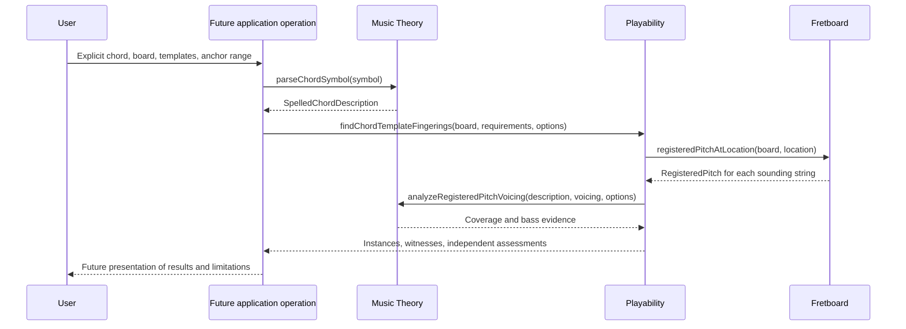

# End-to-end examples

[Onboarding index](README.md) · Previous: [Playability](playability-engine.md) · Next: [Implementation status](../STATUS.md)

These walkthroughs call existing public functions. Each TypeScript block is independent and uses imports as if the caller were at the **repository root**. The assertions make the expected results explicit; Node's assertion module is only a demonstration host dependency, not a domain dependency. Domain `.js` specifiers resolve to TypeScript sources through the project's TypeScript/Vitest setup. Do not assume plain `node example.ts` resolves those specifiers without a build or loader.

The blocks were type-checked and executed against this snapshot in a temporary verification harness; no source, test or tooling file was added. Existing corresponding suites are linked below. To exercise the established integration paths directly, run:

```sh
npm test -- tests/music-theory-readiness.test.ts tests/fretboard-music-theory.test.ts tests/playability.test.ts
```

## 1. Spelled transposition across an octave boundary

**Input:** B-sharp3 and “major second up.” The parser creates a spelled registered note and a numbered, qualified interval. Music Theory separately moves the sounding pitch by two semitones and the written letter by one position. The result is C-double-sharp4 at coordinate 50.

```ts
import assert from "node:assert/strict";
import {
  parseRegisteredNote, formatRegisteredNote, parseNoteSpelling,
} from "./domain/music-theory/pitch-pitch-classes-and-spelling/note-text.js";
import {
  registeredPitchFromNote, pitchClassFromRegisteredPitch,
} from "./domain/music-theory/pitch-pitch-classes-and-spelling/registered-pitch.js";
import {
  parseSpelledInterval, formatSpelledInterval,
} from "./domain/music-theory/intervals-and-transposition/interval-text.js";
import {
  transposeRegisteredNote, identifySpelledInterval,
} from "./domain/music-theory/intervals-and-transposition/spelled-transposition.js";

const from = parseRegisteredNote("B#3");
const interval = parseSpelledInterval("major second up");
assert.deepEqual(from, { letter: "B", accidental: 1, octave: 3 });
assert.deepEqual(interval, { number: 2, quality: "major", direction: "up" });
assert.equal(registeredPitchFromNote(from), 48);

const to = transposeRegisteredNote(from, interval);
assert.deepEqual(to, { letter: "C", accidental: 2, octave: 4 });
assert.equal(formatRegisteredNote(to, "ascii"), "C##4");
assert.equal(registeredPitchFromNote(to), 50);
assert.equal(pitchClassFromRegisteredPitch(50), 2);
assert.equal(formatSpelledInterval(identifySpelledInterval(from, to)), "M2 up");

assert.throws(() => parseNoteSpelling("c#"), SyntaxError);
assert.throws(() => parseSpelledInterval("P3 up"), RangeError);
```

The numeric class 2 could be displayed as D under another explicit spelling policy, but that would discard the interval-derived written role. This flow has no need for Fretboard or Playability. Evidence: [registered-pitch tests](../../tests/registered-pitch.test.ts), [interval measurement](../../tests/interval-measurement.test.ts) and [readiness integration](../../tests/music-theory-readiness.test.ts).

## 2. Relative mode, degree role and registered run

**Input:** derive degree 2 of C major, then descend one octave from the derived tonic at octave 4. The returned tonic is D, and the returned canonical mode is Dorian. F is its third member and formula b3. Reusing C as the tonic afterward would construct a different mode.

```ts
import assert from "node:assert/strict";
import {
  parseNoteSpelling, parseRegisteredNote, formatNoteSpelling, formatRegisteredNote,
} from "./domain/music-theory/pitch-pitch-classes-and-spelling/note-text.js";
import { pitchClassFromSpelling } from "./domain/music-theory/pitch-pitch-classes-and-spelling/note-spelling.js";
import { registeredPitchFromNote } from "./domain/music-theory/pitch-pitch-classes-and-spelling/registered-pitch.js";
import { relativeModeNoteSpellings } from "./domain/music-theory/scales-and-modes/relative-modes.js";
import { scaleRegisteredNotes } from "./domain/music-theory/scales-and-modes/scale-runs.js";
import { melodicMinorRegisteredNotes } from "./domain/music-theory/scales-and-modes/melodic-minor-runs.js";
import { collectionDegreeOfPitchClass, degreeFormulaAtOrdinal } from "./domain/music-theory/degrees-keys-and-spelling/degrees.js";
import { createKey, keySignature } from "./domain/music-theory/degrees-keys-and-spelling/keys.js";
import { spellingFromPitchClassInKey } from "./domain/music-theory/degrees-keys-and-spelling/key-aware-spelling.js";

const mode = relativeModeNoteSpellings(parseNoteSpelling("C"), "major", 2);
assert.equal(mode.mode, "dorian");
assert.deepEqual(mode.noteSpellings.map(n => formatNoteSpelling(n, "ascii")),
  ["D", "E", "F", "G", "A", "B", "C"]);
assert.deepEqual(collectionDegreeOfPitchClass(
  pitchClassFromSpelling(mode.tonic), mode.mode, 5,
), { ordinal: 3, formula: { number: 3, alteration: -1 } });
assert.deepEqual(degreeFormulaAtOrdinal("minor-pentatonic", 2),
  { number: 3, alteration: -1 });

const options = { direction: "down", octaves: 1, includeEndpoint: true } as const;
const run = scaleRegisteredNotes({ ...mode.tonic, octave: 4 }, mode.mode, options);
assert.deepEqual(run.map(registeredPitchFromNote), [50, 48, 47, 45, 43, 41, 40, 38]);
assert.deepEqual(run.map(n => formatRegisteredNote(n, "ascii")),
  ["D4", "C4", "B3", "A3", "G3", "F3", "E3", "D3"]);

const classical = melodicMinorRegisteredNotes(parseRegisteredNote("C5"),
  { ...options, convention: "classical-exercise" });
const fixed = melodicMinorRegisteredNotes(parseRegisteredNote("C5"),
  { ...options, convention: "fixed-collection" });
assert.deepEqual(classical.map(registeredPitchFromNote), [60, 58, 56, 55, 53, 51, 50, 48]);
assert.deepEqual(fixed.map(registeredPitchFromNote), [60, 59, 57, 55, 53, 51, 50, 48]);

const key = createKey(parseNoteSpelling("B"), "minor");
assert.deepEqual(keySignature(key), [
  { letter: "F", accidental: 1 }, { letter: "C", accidental: 1 },
]);
assert.equal(spellingFromPitchClassInKey(10, key), undefined);
assert.deepEqual(spellingFromPitchClassInKey(10, key, { number: 7, alteration: 0 }),
  { letter: "A", accidental: 1 });
```

The final calls demonstrate why key identity, selected collection and spelling role remain separate: B minor's signature stays F-sharp/C-sharp while explicit role 7 can select A-sharp. Evidence: [relative modes](../../tests/relative-modes.test.ts), [degrees](../../tests/degrees.test.ts), [scale runs](../../tests/scale-runs.test.ts), [melodic-minor runs](../../tests/melodic-minor-runs.test.ts) and [key-aware spelling](../../tests/key-aware-spelling.test.ts).

## 3. Harmonization, symbols, realization and identification

**Input:** degree 7 of C harmonic minor, harmonized as a seventh chord. Collection traversal selects B,D,F,A-flat. Root-relative distances `[0,3,6,9]` produce roles `1,b3,b5,bb7`, recognized as diminished seventh. A description can be formatted as Bdim7, parsed back, and realized above B3.

```ts
import assert from "node:assert/strict";
import {
  parseNoteSpelling, parseRegisteredNote, formatRegisteredNote,
} from "./domain/music-theory/pitch-pitch-classes-and-spelling/note-text.js";
import { registeredPitchFromNote } from "./domain/music-theory/pitch-pitch-classes-and-spelling/registered-pitch.js";
import { harmonizedChordNoteSpellingsAtDegree } from "./domain/music-theory/chords-symbols-and-realization/scale-harmonization.js";
import {
  createSpelledChordDescription, chordDescriptionPitchClasses,
} from "./domain/music-theory/chords-symbols-and-realization/chord-descriptions.js";
import {
  parseChordSymbol, formatChordSymbol,
} from "./domain/music-theory/chords-symbols-and-realization/chord-symbols.js";
import { rootPositionChordRegisteredNotes } from "./domain/music-theory/chords-symbols-and-realization/registered-chords.js";
import { identifyChordsFromRegisteredNotes } from "./domain/music-theory/chords-symbols-and-realization/chord-identification.js";

const chord = harmonizedChordNoteSpellingsAtDegree(
  parseNoteSpelling("C"), "harmonic-minor", 7, "seventh",
);
assert.equal(chord.quality, "diminished-seventh");
assert.deepEqual(chord.formula, [
  { number: 1, alteration: 0 }, { number: 3, alteration: -1 },
  { number: 5, alteration: -1 }, { number: 7, alteration: -2 },
]);
const description = createSpelledChordDescription(chord.root, chord.formula);
assert.equal(formatChordSymbol(description), "Bdim7");
assert.deepEqual(parseChordSymbol("Bdim7"), description);
assert.deepEqual(chordDescriptionPitchClasses(description), [11, 2, 5, 8]);

const voicing = rootPositionChordRegisteredNotes(description, parseRegisteredNote("B3"));
assert.deepEqual(voicing.notes.map(n => formatRegisteredNote(n, "ascii")),
  ["B3", "D4", "F4", "Ab4"]);
assert.deepEqual(voicing.notes.map(registeredPitchFromNote), [47, 50, 53, 56]);
const identified = identifyChordsFromRegisteredNotes(voicing);
assert.deepEqual(identified.candidates.map(c => [c.description.root, c.quality]), [
  [2, "diminished-seventh"], [5, "diminished-seventh"],
  [8, "diminished-seventh"], [11, "diminished-seventh"],
]);
assert.deepEqual(identified.bass, { pitch: 47, pitchClass: 11, toneIndices: [0] });

const root = parseRegisteredNote("C4");
const add2 = rootPositionChordRegisteredNotes(parseChordSymbol("Cadd2"), root);
const add9 = rootPositionChordRegisteredNotes(parseChordSymbol("Cadd9"), root);
assert.deepEqual(add2.notes.map(registeredPitchFromNote), [48, 52, 55, 50]);
assert.deepEqual(add9.notes.map(registeredPitchFromNote), [48, 52, 55, 62]);
assert.throws(() => parseChordSymbol("C7(#11)"), SyntaxError);
```

Identification retains four symmetric possibilities even though the caller originally constructed Bdim7. Keep the original description when that identity matters. Observed B3 bass is evidence about this voicing; it does not rewrite candidate descriptions with a specified bass. The add2/add9 calls separately show how compound roles acquire different octaves only under the chosen realization convention.

Sources: [harmonization](../../domain/music-theory/chords-symbols-and-realization/scale-harmonization.ts), [symbols](../../domain/music-theory/chords-symbols-and-realization/chord-symbols.ts), [registered chords](../../domain/music-theory/chords-symbols-and-realization/registered-chords.ts), [identification](../../domain/music-theory/chords-symbols-and-realization/chord-identification.ts). The same integration is covered in [readiness tests](../../tests/music-theory-readiness.test.ts).

## 4. Supplied voicing, slash bass and optional roles

**Input:** C/F-sharp and an explicitly supplied voicing. The slash does not add F-sharp to C-major formula tones. Analysis permits its occurrence only at the actual sounding bass. Root-position generation cannot produce this request, but supplied-voicing analysis can assess it.

```ts
import assert from "node:assert/strict";
import { parseRegisteredNote } from "./domain/music-theory/pitch-pitch-classes-and-spelling/note-text.js";
import { parseChordSymbol } from "./domain/music-theory/chords-symbols-and-realization/chord-symbols.js";
import { chordDescriptionPitchClasses } from "./domain/music-theory/chords-symbols-and-realization/chord-descriptions.js";
import {
  createRegisteredNoteVoicing, rootPositionChordRegisteredNotes,
} from "./domain/music-theory/chords-symbols-and-realization/registered-chords.js";
import { analyzeRegisteredNoteVoicing } from "./domain/music-theory/chords-symbols-and-realization/chord-voicing-analysis.js";
import { identifyChordsFromRegisteredNotes } from "./domain/music-theory/chords-symbols-and-realization/chord-identification.js";

const description = parseChordSymbol("C/F#");
assert.deepEqual(chordDescriptionPitchClasses(description), [0, 4, 7]);
const voicing = createRegisteredNoteVoicing(
  ["C4", "F#2", "E3", "G3", "C3"].map(parseRegisteredNote),
);
const analysis = analyzeRegisteredNoteVoicing(description, voicing);
assert.equal(analysis.bass.pitch, 30);
assert.deepEqual(analysis.bass.toneIndices, [1]);
assert.equal(analysis.specifiedBass, "matched");
assert.deepEqual(analysis.missingRequiredFormulaIndices, []);
assert.deepEqual(analysis.unmatchedToneIndices, [1]);
assert.deepEqual(analysis.allowedSpecifiedBassToneIndices, [1]);
assert.deepEqual(analysis.unexpectedToneIndices, []);
assert.deepEqual(analysis.inversion, { status: "non-chord-bass" });
assert.deepEqual(identifyChordsFromRegisteredNotes(voicing).candidates, []);
assert.throws(() => rootPositionChordRegisteredNotes(description, parseRegisteredNote("C3")), RangeError);

const extra = createRegisteredNoteVoicing([...voicing.notes, parseRegisteredNote("F#5")]);
assert.deepEqual(analyzeRegisteredNoteVoicing(description, extra).unexpectedToneIndices, [5]);

const ninth = parseChordSymbol("C9");
const omittedFifth = createRegisteredNoteVoicing(
  ["E3", "Bb3", "D4", "C5", "C5"].map(parseRegisteredNote),
);
const optional = analyzeRegisteredNoteVoicing(ninth, omittedFifth,
  { optionalFormulaIndices: [2] });
assert.deepEqual(optional.missingRequiredFormulaIndices, []);
assert.deepEqual(optional.missingOptionalFormulaIndices, [2]);
assert.deepEqual(optional.inversion, { status: "unsupported-structure" });
```

Formula position 2 is the fifth because indices are zero-based; it is not musical degree 2. Optionality affects known-chord coverage, not complete formula construction or exact identification. The last voicing still contains two distinct C5 occurrences; neither coverage nor a class set proves that an eventual instrument assignment preserves both. Evidence: [voicing analysis](../../tests/chord-voicing-analysis.test.ts), [identification](../../tests/chord-identification.test.ts) and [readiness integration](../../tests/music-theory-readiness.test.ts).

## 5. Pitches and chord tones become location alternatives

**Input:** an explicit standard-tuning board with twelve frets. An exact D3 search keeps register, while a D-class search includes higher octaves. Mapping chord roles retains each formula index and role beside its location list.

```ts
import assert from "node:assert/strict";
import {
  createFretboard, findRegisteredPitchLocations, findPitchClassLocations,
  registeredPitchAtLocation,
} from "./domain/fretboard/fretboard.js";
import { parseChordSymbol } from "./domain/music-theory/chords-symbols-and-realization/chord-symbols.js";
import { chordDescriptionPitchClasses } from "./domain/music-theory/chords-symbols-and-realization/chord-descriptions.js";

const board = createFretboard(
  [52, 47, 43, 38, 33, 28].map((openPitch, i) =>
    ({ id: i + 1, position: i + 1, openPitch })),
  12,
);
assert.equal(registeredPitchAtLocation(board, { stringId: 6, fret: 5 }), 33);
assert.deepEqual(findRegisteredPitchLocations(board, 38), [
  { stringId: 4, fret: 0, pitch: 38 },
  { stringId: 5, fret: 5, pitch: 38 },
  { stringId: 6, fret: 10, pitch: 38 },
]);
assert.equal(findPitchClassLocations(board, 2).length, 7);
assert.deepEqual(findRegisteredPitchLocations(board, 38,
  { stringIds: [6, 5], frets: { min: 5, max: 10 } }), [
  { stringId: 5, fret: 5, pitch: 38 }, { stringId: 6, fret: 10, pitch: 38 },
]);
assert.throws(() => findPitchClassLocations(board, 2,
  { stringIds: [], frets: { min: 0, max: 13 } }), RangeError);

const description = parseChordSymbol("C9");
const mappedRoles = chordDescriptionPitchClasses(description).map((pitchClass, formulaIndex) => ({
  formulaIndex,
  role: description.formula[formulaIndex]!,
  pitchClass,
  locations: findPitchClassLocations(board, pitchClass),
}));
assert.deepEqual(mappedRoles.map(r => r.role.number), [1, 3, 5, 7, 9]);
assert.equal(mappedRoles.every(r => r.locations.length > 0), true);

const requested = [38, 38, 120];
const occurrences = requested.map((pitch, sourceIndex) => ({
  sourceIndex, pitch, locations: findRegisteredPitchLocations(board, pitch),
}));
assert.deepEqual(occurrences.map(o => o.locations.length), [3, 3, 0]);
assert.deepEqual(occurrences.map(o => o.sourceIndex), [0, 1, 2]);
```

The two D3 requests retain two entries even though their alternatives are equal. Coordinate 120 remains explicitly unavailable. A consumer must not filter it out and call the remainder a successful realization.

**Stop at this boundary:** `mappedRoles` is not a chord shape. It contains many alternatives, potentially conflicting on the same strings. The repository has no general solver that transforms these arbitrary lists into simultaneous grips. The next example uses the separately implemented known-template search instead. Evidence: [Fretboard tests](../../tests/fretboard.test.ts) and [Fretboard/Music Theory integration](../../tests/fretboard-music-theory.test.ts).

## 6. A chord symbol to a reviewed template fingering

**Input:** A-flat major, a 24-fret standard-tuning board, the selected `closed-e-major` template and anchors 1..12. Music Theory parses the request. Playability enumerates that pattern's placements, Fretboard supplies actual pitches, and Music Theory analysis determines which placements match.

```ts
import assert from "node:assert/strict";
import { createFretboard } from "./domain/fretboard/fretboard.js";
import { parseChordSymbol } from "./domain/music-theory/chords-symbols-and-realization/chord-symbols.js";
import { findChordTemplateFingerings } from "./domain/playability/template-search.js";

const board = createFretboard(
  [52, 47, 43, 38, 33, 28].map((openPitch, i) =>
    ({ id: i + 1, position: i + 1, openPitch })),
  24,
);
const results = findChordTemplateFingerings(board,
  { description: parseChordSymbol("Ab") },
  { templateIds: ["closed-e-major"], anchorRange: { min: 1, max: 12 } },
);
assert.equal(results.length, 1);
const result = results[0]!;
assert.equal(result.anchor, 4);
assert.deepEqual([...result.instance.strings].reverse().map(s => "fret" in s ? s.fret : "x"),
  [4, 6, 6, 5, 4, 4]);
assert.equal(result.assessment.musical.status, "matched");
assert.deepEqual(result.assessment.physicalSupport,
  { status: "supported", templateIds: ["closed-e-major"] });
assert.equal(result.assessment.recommendationEligible, true);

const structure = result.assessment.structural;
assert.equal(structure.status, "valid");
if (structure.status !== "valid") throw new Error("Expected valid geometry");
assert.deepEqual(structure.soundingLocations.map(l => l.pitch), [56, 51, 48, 44, 39, 32]);
const witness = result.assessment.witnessFindings[0]!.validation;
if (witness.status !== "valid") throw new Error("Expected valid contacts");
assert.deepEqual([...witness.soundingFingers].reverse().map(f => f.finger), [1, 3, 4, 2, 1, 1]);
assert.equal(witness.contactSpan, 2);

const octavePlacements = findChordTemplateFingerings(board,
  { description: parseChordSymbol("Ab") },
  { templateIds: ["closed-e-major"], anchorRange: { min: 1, max: 24 } },
);
assert.deepEqual(octavePlacements.map(r => r.anchor), [4, 16]);
```

The intermediates explain the result:

| Stage | Representation/result |
| --- | --- |
| Musical identity | A-flat root, roles 1/3/5; sounding classes 8/0/3. |
| Selected geometry | `shape-08`, relative frets 6 → 1: `0 2 2 1 0 0`. |
| Placement | Anchor 4 adds four to every sounding offset. |
| Complete contacts | Finger 1 barres positions 1..6 at fret 4; finger 2 stops position 3 at 5; fingers 3/4 stop positions 5/4 at 6. |
| Sounding notes, 6 → 1 | A-flat2, E-flat3, A-flat3, C4, E-flat4, A-flat4. |
| Music | All required classes covered, no unexpected tones, bass unspecified. |
| Support | Actual geometry and complete execution match the reviewed closed E-major pattern. |

The output contains one known supported execution at each matching anchor, not every possible A-flat voicing. A wider range admits an octave-displaced placement because there was no exact-register request. The same tested path finds A-flat minor using `closed-e-minor` at anchor 4 and D major using `closed-c-major` at anchor 2. Evidence: [Playability integration tests](../../tests/playability.test.ts), [relative-template tests](../../tests/fingering-template.test.ts) and [the consumer guide](../PLAYABILITY_V1.md).

## 7. Exact occurrences and separate support findings

**Input:** the existing open C-major geometry, with C-major-seventh identity whose seventh is explicitly optional. Its five sounding occurrences are C3,E3,G3,C4,E4. Coverage permits the absent B, but an exact request including B3 must still fail.

```ts
import assert from "node:assert/strict";
import { createFretboard } from "./domain/fretboard/fretboard.js";
import { parseChordSymbol } from "./domain/music-theory/chords-symbols-and-realization/chord-symbols.js";
import { instantiateReferenceChordShape } from "./domain/playability/reference-grips.js";
import { assessChordShape } from "./domain/playability/playability.js";

const board = createFretboard(
  [52, 47, 43, 38, 33, 28].map((openPitch, i) =>
    ({ id: i + 1, position: i + 1, openPitch })),
  12,
);
const instance = instantiateReferenceChordShape(board, "open-c-major");
const requirements = {
  description: parseChordSymbol("Cmaj7"),
  optionalFormulaIndices: [3],
  exactVoicing: { pitches: [36, 40, 43, 48, 52] },
};
const assessment = assessChordShape(board, instance, requirements);
assert.equal(assessment.recommendationEligible, true);
if (assessment.musical.status === "not-assessed") throw new Error("Expected musical assessment");
assert.equal(assessment.musical.exactMatch, true);
assert.deepEqual(assessment.musical.occurrenceLocationIndices, [4, 3, 2, 1, 0]);
assert.deepEqual(assessment.musical.analysis?.missingOptionalFormulaIndices, [3]);

const missingExactB = assessChordShape(board, instance, {
  ...requirements, exactVoicing: { pitches: [36, 40, 43, 48, 52, 47] },
});
assert.equal(missingExactB.musical.status, "mismatched");
assert.equal(missingExactB.physicalSupport.status, "supported");
assert.equal(missingExactB.recommendationEligible, false);

const noWitnesses = assessChordShape(board, instance, requirements, []);
assert.equal(noWitnesses.musical.status, "matched");
assert.equal(noWitnesses.physicalSupport.status, "unverified");
assert.equal(noWitnesses.recommendationEligible, false);
```

Indices `[4,3,2,1,0]` refer to the resolver's physical-position-ordered **sounding locations**, not all six string-state rows and not original string IDs. They connect each requested occurrence to a distinct actual occurrence. The absent seventh cannot be excused by formula optionality after the caller explicitly requests its registered occurrence.

Omitted witnesses allow matching reviewed templates to be instantiated; explicit `[]` supplies none. The same valid geometry can therefore match music while remaining unsupported for recommendation. Evidence: [assessment source](../../domain/playability/playability.ts) and [musical-requirement tests](../../tests/playability.test.ts).

## 8. Where a future UI or AI layer fits

The implemented call paths above can be invoked by a future application operation. A direct user control could select a board, chord symbol and templates; an AI interpreter could produce the same explicit choices. Both should call `parseChordSymbol`/description constructors and `findChordTemplateFingerings`, retain their inputs and return separate assessment findings for presentation.



The application/interaction arrows are **design intent**, not existing route handlers or UI behavior. No AI model, request schema, state store, tool protocol or rendering API has been implemented. For an ambiguous request such as “melodic minor down,” the consumer must obtain or explicitly choose a supported convention before calling deterministic functions. For “find any fingering for this arbitrary voicing,” the available template search is not a general solver; stop at that limit rather than presenting invented results.
