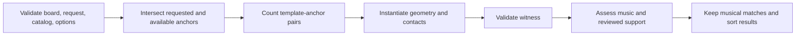

# Playability Engine

[Onboarding index](README.md) · Previous: [Fretboard](fretboard-engine.md) · Next: [End-to-end examples](end-to-end-examples.md)

Playability v1 implements a bounded, useful path: place selected known patterns, validate complete finger contacts, check their actual sounding music, and recognize reviewed execution patterns. It also assesses explicitly supplied geometry and witnesses. It does not derive arbitrary shapes, solve new finger assignments or score ergonomic preference.

Its design separates **geometry**, **execution** and **review evidence**. This matters because the same frets can have several fingerings, and a contact-consistent fingering is not automatically a reviewed recommendation. [D056](../DECISIONS.md#d056-reusable-playability-templates-and-bounded-placement-search) and the revised [Playability plan](../../plans/playability-engine-v1.md) define the current scope. The plan's earlier fixed-placement restrictions are historical.

## The five representations

| Representation | What it contains | What it intentionally excludes |
| --- | --- | --- |
| `ChordShapeFormula` | ID, physical string positions, explicit states and relative sounding-fret offsets. | Tuning, chord name, fingers, barres and approval. |
| `ChordShapeInstance` | ID, board string IDs/positions, explicit states, absolute sounding frets, optional provenance. | Finger execution and approval. |
| `FingeringWitness` | ID, instance association and complete absolute finger contacts. | A second geometry copy and review claims. |
| `FingeringTemplate` | ID, formula association and complete relative finger contacts. | Concrete placement and trusted review evidence. |
| `TemplateReview` | Reviewed template identity, source, six-string compatibility and tuning policy. | A shortcut around actual geometry/contact validation. |

“Formula” here means a physical shape pattern; it is different from Music Theory's chord degree formula. An E-shaped physical pattern is not permanently the E-major musical object: moving it or changing tuning changes what it sounds.

## Geometry is complete and independent of fingers

[chord-shape-formula.ts](../../domain/playability/chord-shape-formula.ts) provides `createChordShapeFormula(id, strings)`, `validateChordShapeFormula(formula)`, `chordShapeFormulasEqual(left, right)` and `instantiateChordShape(board, formula, anchor, instanceId)`.

Each formula describes every physical position exactly once. The states are:

| State | Formula data | Concrete instance data | Sound |
| --- | --- | --- | --- |
| `open` | No offset | `fret: 0` | Open-string pitch. |
| `fretted` | Nonnegative safe `offset` | Positive available `fret` | Pitch at the selected stop. |
| `muted` | No offset | No fret | No supplied tone; muting technique is not specified. |
| `unplayed` | No offset | No fret | String omitted from played strings. |

Muted and unplayed are distinct even though both are silent. Reference tables use `x` for **unplayed**. A zero relative offset in a closed formula means a fretted stop at the anchor, not an open string.

### Anchor rules

If any string is open, the formula uses the nut as origin: its fretted offsets must be positive and placement anchor must be zero. A closed formula with sounding fretted stops normalizes its lowest sounding offset to zero and uses a positive anchor. All-open and all-silent formulas are structurally allowed and use anchor zero.

Construction rejects non-normalized data; it does not silently subtract a minimum. Formula equality canonicalizes physical-position order and compares states/offsets, ignoring IDs and unrelated metadata. Finger contacts do not affect normalization.

Instantiation validates the board and formula, requires the same string count, maps physical positions to stable board IDs, and adds anchor to fretted offsets with checked BigInt arithmetic. It then calls structural resolution. Unavailable/unsafe placements throw `RangeError`.

For the closed E-major geometry, offsets on positions 6 → 1 are `0 2 2 1 0 0`. At anchor 4, the absolute frets are `4 6 6 5 4 4`. The numeric pitch comes later from the supplied board; the geometry contains no A-flat-major label.

## Structural resolution uses actual board facts

[chord-shape.ts](../../domain/playability/chord-shape.ts) exports `resolveChordShape(board, instance)` and `chordShapeInstancesEqual(board, left, right)`. A concrete instance can be supplied without any formula/provenance. It must cover every board string once with matching physical position and stable ID. Open frets must be zero, fretted stops positive/available, and silent states must not carry a fret.

The resolver validates and copies the geometry, sorts by physical position, and calls Fretboard's `registeredPitchAtLocation` for every sounding string. Its valid result includes the copied instance and `soundingLocations`, preserving repeated sounding pitches in **physical-position order**. That order differs from Fretboard search's ID order.

Candidate contradictions return `{ status: "invalid", reasons }`; malformed boards throw under Fretboard's contract. The current validators usually return the first detected reason, not an exhaustive error report. Geometry comparison throws if either candidate is invalid, otherwise compares actual canonical string states.

Optional `{ formulaId, anchor }` provenance is copied after basic field validation, but is not used to establish geometry identity or support. A familiar ID or plausible origin cannot override the supplied string states.

## Absolute contacts and barres

[fingering-witness.ts](../../domain/playability/fingering-witness.ts) defines `FingerContact` as `{ finger, fret, fromPosition, toPosition }`. `FrettingFinger` is 1 index, 2 middle, 3 ring or 4 little finger. Equal endpoint positions mean a single stop; a larger inclusive interval is a continuous **barre**, one finger pressing multiple adjacent strings at one fret.

A `FingeringWitness` contains `{ id, instanceId, contacts }`. `validateFingeringWitness(board, instance, witness)` first resolves actual geometry and checks the association, then validates the contacts:

1. At most four dense contact records; each finger appears at most once.
2. Positive available safe fret and an ordered inclusive physical-position interval.
3. For each string, gather **all** contacts whose intervals cover that position.
4. Reject different fingers owning the same string/fret contact, including hidden or silent-string overlaps.
5. Keep every intended open string clear of all fretting contacts.
6. For each sounding fretted string, require its highest contact to equal the selected stop.

Different fingers can hold the same fret on different strings. They can also cover the same string at different frets: the higher stop determines sound while a lower barre remains held. The checker inspects intervening strings, not only the barre's endpoints. It therefore rejects a barre that passes across an intended open string.

For standard-tuning F major `1 3 3 2 1 1` on strings 6 → 1, finger 1 holds fret 1 across all six positions; fingers 3,4,2 hold the higher stops on positions 5,4,3. Six sounding strings require four fingers. The barre still contributes contacts underneath those higher stops.

A valid finding returns copied contacts in finger order, `soundingFingers` in physical-position order (0 denotes open), and `contactSpan = max held fret - min held fret`, or `null` with no contacts. Hidden lower contacts and contacts on silent strings count in that span. Silent state declarations themselves add no contact or tone.

The checker enforces no general finger-order, neighboring-finger gap, maximum span, hand-position, active-muting or anatomical reach rule. A valid witness establishes discrete consistency only. One invalid witness does not prove all executions of the geometry are impossible.

## Relative templates make closed patterns movable

[fingering-template.ts](../../domain/playability/fingering-template.ts) defines `RelativeFingerContact` with `offset` instead of absolute fret. Offsets are signed safe integers. A negative offset can describe a hidden lower barre below the lowest **sounding** stop, without changing the geometry anchor.

`createFingeringTemplate(formula, template)` validates/copies the association and record representation, sorting contacts by finger. Duplicate finger duties can survive this representation check and fail later as a concrete contact-consistency finding. This is deliberate separation between well-formed relative data and simultaneous execution.

`templateAnchorBounds(board, formula, template)` returns inclusive `{ min, max }` or `null`. Begin with anchor zero for nut-origin geometry or positive anchors for closed geometry. Every sounding or held contact offset `o` requires:

```text
1 <= anchor + o <= fretCount
therefore: 1 - o <= anchor <= fretCount - o
```

Intersect these bounds for all offsets using BigInt. A hidden offset -2 raises the minimum anchor to at least 3. String-count incompatibility or an empty intersection yields `null`. Bounds establish coordinate availability, not contact consistency.

`instantiateTemplateFingering(board, formula, template, anchor, instanceId, witnessId?)` places geometry and all relative contacts, then invokes the existing witness validator. It returns `{ instance, validation }`, with the witness inside a valid validation result. Malformed representations, association mismatches and unavailable coordinates throw; simultaneous contact contradictions are invalid findings. There is no finger remapping or arbitrary open-to-closed conversion.

## Reference data, variants and trusted support

[reference-grips.ts](../../domain/playability/reference-grips.ts) supplies fresh-copy getters for 13 geometries and 13 execution templates: five open major CAGED forms and eight closed forms. **CAGED** refers to patterns based on the familiar C,A,G,E,D major shapes. The closed catalog contains those five major forms plus A-, E- and D-shaped minor forms.

The original 13 absolute placements remain fixtures. F major and E-shaped C major share `shape-08` and its execution template. The later closed C-major variant is `shape-13`; it has no additional historical absolute placement. Its geometry at anchor 2 produces D major `x 5 4 2 3 2`, with sounding fingers `x 4 3 1 2 1`.

`referenceClosedCagedVariants()` lists explicit open/closed associations, and `closedCagedFingeringTemplate(openTemplateId)` selects one or throws. It retrieves defined data, not a conversion algorithm. `referenceFingeringWitnesses()` derives historical absolute contacts from templates plus placement anchors. `referenceFingeringReviews()` retains their standard-tuning source context for compatibility.

Current movable support uses separate `referenceTemplateReviews()`. Its explicit reviewed-ID list is independent of template membership: adding execution data does not automatically approve it. At assessment module initialization, private snapshots join reviews to actual formulas/templates. Support matching checks actual normalized geometry and complete canonical contacts, including finger identities and barre extents. IDs, provenance and caller-provided catalogs cannot grant approval.

Reviewed patterns apply across compatible six-string tunings and available placements. Actual tuning still controls musical matching. A retuned E shape may remain physically supported while producing the wrong chord. Swapping ring and little fingers can remain contact-valid while losing reviewed-pattern support. Conversely, renaming an unchanged pattern does not remove its actual match.

## Musical requirements and independent assessment

[playability.ts](../../domain/playability/playability.ts) defines `ChordShapeRequirements`:

```ts
{
  description: PitchClassChordDescription | SpelledChordDescription;
  optionalFormulaIndices?: readonly number[];
  exactVoicing?: RegisteredPitchVoicing | RegisteredNoteVoicing;
}
```

`copyChordShapeRequirements(request)` snapshots descriptions and original occurrences and reuses Music Theory validation for formula/optional-index/voicing contracts. It does not select a voicing. A request containing a musically mismatching exact voicing is evaluated as a mismatch, not silently rewritten.

`assessChordShape(board, instance, requirements, witnesses?)` returns a `PlayabilityAssessment` with separate findings:

| Field | Interpretation |
| --- | --- |
| `structural` | Valid copied geometry/locations or invalid reasons. |
| `musical` | `matched`, `mismatched` or `not-assessed`, with numeric analysis, exact-match status and occurrence association when applicable. |
| `physicalSupport` | `supported`, `unverified` or `not-assessed`, with matching reviewed template IDs. |
| `witnessFindings` | Independent validation and supporting template IDs for each witness. |
| `recommendationEligible` | True only when structure is valid, music matches and at least one valid execution matches a reviewed pattern. |

Invalid structure leaves dependent music/support `not-assessed`. Valid but silent geometry is musically mismatched and has `analysis: null`. With sounding pitches, the assessor delegates to `analyzeRegisteredPitchVoicing`. Music matches when required roles are covered, no unexpected tones remain, and specified bass is not mismatched. Unspecified bass permits inversions. Inversion classification itself is not an eligibility requirement.

### Exact voicing means a multiset of registered occurrences

When `exactVoicing` exists, class coverage is insufficient. Assessment groups actual pitches into queues of physical-position-ordered sounding-location indices. For each original requested occurrence, it consumes one index from the matching pitch's queue. Equal total lengths plus one available index per request establish exact multiset equality: same coordinates and same multiplicity, regardless of input order.

`occurrenceLocationIndices` is returned in request order when exact matching succeeds; on failure it is `null`. Without an exact request, both that field and `exactMatch` are `null`. An optional formula role cannot authorize deleting a supplied exact occurrence.

For spelled descriptions with spelled exact voicings, the original requested notes also undergo `analyzeRegisteredNoteVoicing`. The board's numeric locations are not respelled to manufacture membership. Thus B-sharp2 can numerically occupy a requested C3 location, but that substitution does not count as exact written C membership. The numeric `analysis` returned in the finding does not expose the additional spelled analyzer result; `exactMatch` can be true while overall music is mismatched because of written membership. This is useful when interpreting diagnostics.

### Witness selection and support are independent of music

Omitting `witnesses` instantiates matching reviewed patterns. Passing `[]` explicitly supplies no witnesses. Explicit witnesses are checked independently; an invalid one cannot veto a valid supported alternative. Recommendation eligibility requires at least one supported execution, not universal agreement among alternatives.

Musical mismatch does not erase physical support. Unreviewed contact-valid patterns remain `unverified`, not “physically impossible.” Support is evidence within the declared discrete pattern model, not a guarantee of comfort for every player.

## Bounded known-template search

[template-search.ts](../../domain/playability/template-search.ts) exports:

```ts
findChordTemplateFingerings(board, requirements, options, catalog?)
```

`TemplateSearchOptions` requires unique known `templateIds` and an inclusive `anchorRange: { min, max }` inside `0..fretCount`. The optional `TemplateCatalog` supplies formula/template arrays; the default is the reference data. The range bounds **anchors**, not every sounding fret. Anchor 4 may legitimately produce fret 6.

The search pipeline is:



All catalog formulas/templates are checked for valid representation, unique IDs and known associations, even when selection is empty. Each selected template's coordinate bounds are intersected with the requested range. Open forms contribute only anchor zero. `MAX_TEMPLATE_SEARCH_PLACEMENTS` is 10,000, counted **before** contact or musical filtering. A request with 10,001 available pairs rejects even if only one would match the chord. BigInt counting and iteration preserve safe boundary behavior; there is no truncation.

The search skips invalid concrete witnesses, assesses the rest with that explicit witness, and retains musical matches. Results contain anchor, formula/template IDs, instance, witness and assessment, sorted by anchor, formula ID and template ID. Alternative executions remain separate. Empty selection, unavailable placements or no musical matches return `[]` after validation.

Custom catalogs can return unreviewed but musically matched/contact-valid results. Callers requiring recommendations must filter `assessment.recommendationEligible`. A custom pattern that actually matches reviewed geometry and contacts can receive support; its label alone cannot. No search result is scored or ranked ergonomically.

## Reference heuristics versus executable rules

The [Playability Reference](../PLAYABILITY_REFERENCE.md#one-shared-grip-and-fret-span) discusses compactness, ordinary span ≤4, reviewed span-5 stretches, neighboring-finger gaps and preferred finger order. Those are recommendation knowledge and review guidance. Current code computes contact span but does not implement those as a general heuristic evaluator or hard numerical limits. It recognizes specifically reviewed complete patterns after coordinate/contact checks.

Future ranking may compare span, awkward arrangements, barre extent and finger count **after** validity, according to the reference. Weights, tie-breaking, additional exceptions, stronger reach guarantees and player-specific preferences are undecided. Hand positions, thumb fretting, active muting, melodic transitions, arbitrary shape generation and fingering solving remain unimplemented.

Reference geometry records store explicit stable IDs alongside their string states. Reordering or inserting records does not reassign existing IDs. [Catalog regression tests](../../tests/playability-reference.test.ts) protect the ID-to-geometry mapping, unique identities and valid associations; review support still depends on actual geometry and contacts.

## Tests to read

| Evidence | What it protects |
| --- | --- |
| [chord-shape-formula.test.ts](../../tests/chord-shape-formula.test.ts) | Normalization, identity independence, anchors, exact arithmetic and formula copies. |
| [playability-shape.test.ts](../../tests/playability-shape.test.ts) | Complete geometry, actual pitches, physical order, historical rows and malformed candidates. |
| [playability-witness.test.ts](../../tests/playability-witness.test.ts) | Complete barres, intervening strings, hidden contacts, exclusive contact ownership and alternative witnesses. |
| [fingering-template.test.ts](../../tests/fingering-template.test.ts) | Every closed pattern over available anchors, negative hidden offsets, bounds and explicit variants. |
| [playability.test.ts](../../tests/playability.test.ts) | A-flat major/minor and D-major search, retuning, exact occurrences/spelling, forged IDs, custom catalogs, sorting and budgets. |

The [consumer guide](../PLAYABILITY_V1.md) summarizes the contract. [Walkthroughs 6 and 7](end-to-end-examples.md#6-a-chord-symbol-to-a-reviewed-template-fingering) show the implemented complete path and explain precisely where general generation stops.
